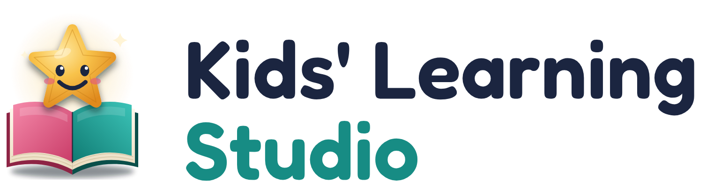

# Kids' Learning Studio

<p align="center">
  <picture>
    <source media="(prefers-color-scheme: dark)" srcset="brand/png/wordmark-dark.png">
    
  </picture>
</p>

A free learning home screen for children (about 4–10 years) that parents install from a browser link on an
Amazon Fire, Android tablet or iPad. Missions earn stars, stars earn screen time, and everything stays on the
family's own device: no accounts, no tracking, no server.

Developed by Oluwasedago.

> **Status: in development (v1).** Not ready for families yet. Install steps, screenshots and the full privacy
> statement come with the first release.

- App (preview): https://oluwasedago.github.io/kids-learning-studio/
- How it works: [product map](docs/product-map.html) (open the file in a browser)
- Brand and logo files: [brand/](brand/README.md)
- Licence: [MIT](LICENSE). Pictures: [Microsoft Fluent Emoji](public/emoji/CREDITS.md) (MIT). Fonts: Andika and Fredoka (SIL OFL).

## For contributors

You need [Node.js](https://nodejs.org) 24 or newer.

```sh
npm install        # once
npm run dev        # the app at http://localhost:5173 (changes show at once)
npm test           # unit tests
npm run build      # the finished site in dist/
```

Every push to `main` is checked, built and published to GitHub Pages by `.github/workflows/deploy.yml`.

Before your first commit, turn on the privacy check (it blocks private words and secrets):

```sh
git config core.hooksPath .githooks
cp .private-words.example.txt .private-words.txt   # then list your own family's names, school, etc.
```
